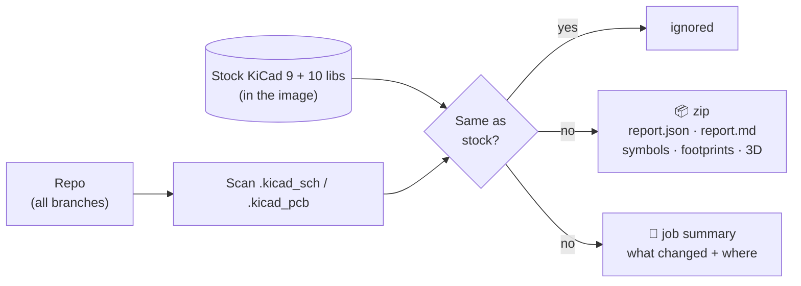

# ConstructFeeder

Finds the custom parts in your KiCad 9/10 projects and packs them into one zip.



| Flag | Custom when… |
|---|---|
| `symbol` / `footprint` | it comes from a project library |
| `symbolLocal` / `footprintLocal` | it was edited on the schematic / board |
| `model` | the 3D model is not stock |

## Use

```yaml
- uses: actions/checkout@v4
  with: { fetch-depth: 0 }
- id: feeder
  uses: Alacrity-Education/ConstructFeeder@v1
  with: { all-branches: "true" }
- uses: actions/upload-artifact@v4
  with: { name: construct-feeder, path: "${{ steps.feeder.outputs.zip }}" }
```

Options, CLI, Docker and releases: [docs/reference.md](docs/reference.md).
